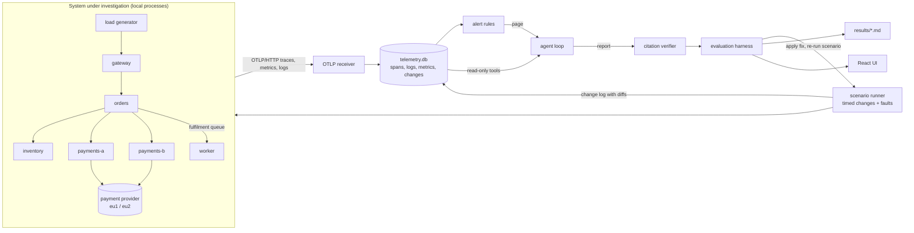

# incident-agent

An agent that investigates incidents in a small distributed system. It reads traces,
logs, metrics, the change log and the deployed source tree through typed read-only tools,
and writes a report with a timeline, the hypotheses it rejected, a root cause with cited
evidence and a proposed fix as a diff. Every citation is checked against the telemetry
store by code, and every fix that applies is checked by re-running the incident with it.

I wanted to measure the agent, not demo it. I inject ten faults with known root causes
into a live, OpenTelemetry-instrumented system, let a local 4B model (through MLX) and two
non-LLM baselines investigate the same recorded telemetry, and score each report against
ground truth with code instead of an LLM judge. The numbers below come from that harness
and are committed in [`results/`](results/).

The short version: the infrastructure works (live system, fault injection, citation
verification, fix re-runs, controls), and the local 4B model is not good enough to use
it. It finds the right service in 60% of runs but never the full root cause, and none of
its diffs apply. A rule-based baseline I wrote for these faults is right 70% of the time.

## Results

I ran 30 investigations per backend: 10 scenarios × 3 independently recorded replicates,
all on a MacBook Air (Apple M4, 16 GB) in October 2026.

| backend | report accepted | root cause correct (95% CI) | service · category · change right | evidence valid | fix applies | fix verified by re-run | median tool calls | median time |
|---|---|---|---|---|---|---|---|---|
| local model: Qwen3-4B-Instruct-2507 (4-bit, MLX) | 17% | 0% (0-11%) | 60% · 40% · 20% | 65% | 0% | 0% | 16 | 228 s |
| baseline: rules | 100% | 70% (52-83%) | 80% · 80% · 80% | 100% | 90% | 70% | - | 0.1 s |
| baseline: roll back latest change | 100% | 0% (0-11%) | 40% · 0% · 30% | 100% | 100% | 30% | - | 0.0 s |

- Root cause correct needs an accepted report with the right service, category and
  culprit change (or no change, when none caused it). The rollback baseline always answers
  category `other`, so it is never correct by construction; it is there to measure what
  "revert the last deploy" achieves as a fix.
- Fix verified: the proposed diff is applied, the scenario is re-run with the same
  operational faults, and the service level must hold. All ten scenarios fail this check
  without a fix and pass it with their reference fix ([`results/controls.md`](results/controls.md)).
- The rules baseline's 3/3 on `retry_storm` counts only because that scenario accepts
  `timeout_misconfiguration` as well as `retry_storm` (the 10 ms timeout and the retries
  both cause it; see the scenario file). It answers `timeout_misconfiguration`.
- Per-scenario results, predicted categories and the prompt-injection table are in
  [`results/summary.md`](results/summary.md); every run is in [`results/runs.jsonl`](results/runs.jsonl).
- The Claude backend (`--backend anthropic`) is implemented and unit-tested, but I had no
  API key configured for this evaluation, so it has no row.

| scenario | what happens | local model | rules | rollback |
|---|---|---|---|---|
| bad_feature_flag | `tax_v2` flag enabled; the new code path raises for some regions | 0/3 · 0/3 | 3/3 · 3/3 | 0/3 · 0/3 |
| memory_leak | orders keeps every order in a dict; OOM-killed at its 130 MB limit | 0/3 · 0/3 | 3/3 · 3/3 | 0/3 · 0/3 |
| n_plus_one | inventory refactor: one query per warehouse (101 per reservation) | 0/3 · 0/3 | 3/3 · 3/3 | 0/3 · 0/3 |
| poison_message | gateway stops normalising a field; worker retries one message forever | 0/3 · 0/3 | 0/3 · 0/3 | 0/3 · 3/3 |
| pool_exhaustion | orders DB pool shrunk from 10 to 2 | 0/3 · 0/3 | 3/3 · 3/3 | 0/3 · 3/3 |
| provider_latency | external payment provider region degrades; no change involved | 0/3 · 0/3 | 0/3 · 0/3 | 0/3 · 0/3 |
| replica_disk_full | scheduled export fills one payments replica's volume | 0/3 · 0/3 | 3/3 · 3/3 | 0/3 · 0/3 |
| retry_storm | inventory timeout set below its median latency, 8 retries, no backoff | 0/3 · 0/3 | 3/3 · 3/3 | 0/3 · 3/3 |
| slow_query_migration | migration rebuilds the stock table without its indexes | 0/3 · 0/3 | 0/3 · 0/3 | 0/3 · 0/3 |
| timeout_mismatch | gateway's upstream timeout cut below orders' latency | 0/3 · 0/3 | 3/3 · 3/3 | 0/3 · 0/3 |

Cells: root cause correct · fix verified, out of 3 replicates. Every scenario also
contains at least one decoy change.

## Walkthrough: one real investigation

`pool_exhaustion`, replicate 2, local model. The scenario: at t=7 s a decoy config change
raises inventory's log level threshold; at t=13 s change `chg-81744c0c` shrinks the orders database
pool from 10 to 2 connections. Orders holds a pooled connection across its inventory and
payments calls, so requests start queueing in `db.pool.acquire`. The alert rule fires on
the recorded telemetry:

```
PAGE: CheckoutLatencyP95 on gateway
gateway POST /checkout p95 latency above 400ms for 15s (peak 549ms)
```

The agent's tool calls (16 of 16 allowed, 284 s, 111k prompt tokens, 18k of them
processed after KV-cache reuse), abridged:

```
 1 list_services   {}                                          -> 6 services, inventory on 2 versions
 2 span_stats      {group_by: service, 18:23:56-18:24:11}      -> orders p95 432 ms, inventory p95 14 ms
 3 search_spans    {service: gateway, name: checkout}          -> slowest POST /checkout 733 ms
 5 metric_series   {name: checkout.p95}                        -> unknown metric; list of real metrics
 6-8 search_spans  {service: orders, name: checkout} ...       -> 0 matches (span names guessed)
10 get_trace       {trace_id: e4d6183f...}                     -> 18 spans, 370 ms in db.pool.acquire
11 metric_series   {name: db.pool.wait_time, service: orders}  -> mean wait 0 -> 129 -> 300 ms
12 list_changes    {change_id: c1a2b3c4...}                    -> error; known ids: chg-104f7540, chg-81744c0c
13 read_file       {path: a/config/orders.toml}                -> pool_size = 2, acquire_timeout_ms = 500
15 submit_report                                               -> accepted, but fix.diff does not apply
18 submit_report                                               -> recorded with verification errors
```

The report it submitted (excerpt):

```json
"root_cause": {
  "service": "orders",
  "category": "connection_pool_exhaustion",
  "change_id": null,
  "summary": "... The default pool size of 2 connections is insufficient for peak load ...",
  "evidence": ["span:45035829decdbe48", "metric:db.pool.wait_time", "span:c6b388eeb1113945"]
}
```

All eight cited references exist, so the report is accepted. It is still scored wrong:
the agent read `pool_size = 2`, was told the two change ids, and never opened
`chg-81744c0c`'s diff, so it called the value a default and blamed no change. Its fix
adds `+ pool_size = 8` under hunk context lines with an extra leading space, so the
diff does not apply to the deployed file. The rule-based baseline, on the same snapshot,
attributes the extra latency to connection-pool self-time in orders, picks the latest
orders change and rolls it back; that diff restores `pool_size = 10` and passes the
re-run.

The UI shows this investigation with the tool-call timeline, each cited reference and
its verifier verdict, the cited trace as a waterfall and the diff:
`uv run ia export-ui && cd ui && npm run dev`, then pick `pool_exhaustion` / the local
model in the sidebar.

## Architecture



- System (`system/`): six Python/FastAPI services with SQLite databases (one million
  stock rows in inventory) and a SQLite-backed fulfilment queue. Each one is instrumented
  with the OpenTelemetry SDK: server/client/database spans, a connection-pool span,
  metrics (pool usage and wait, retries, queue depth, process memory) and logs with trace
  and span ids. Services run as local processes; a supervisor restarts crashed ones and
  writes rollouts and restarts to a `platform` log, as a container platform would.
- Telemetry (`src/incident_agent/telemetry/`): a small OTLP/HTTP receiver (protobuf
  decoding with the official `opentelemetry-proto` messages) that writes spans, logs and
  metric points into one SQLite file per run. I wrote this receiver instead of running
  the OpenTelemetry Collector binary so the project runs with `uv sync` and no extra install;
  the services speak standard OTLP and could point at a Collector unchanged.
- Scenarios (`scenarios/*/scenario.toml`): timed events applied to the running
  system under load. Recorded changes are exact text edits to the deployed tree, rendered
  as unified diffs into the change log, followed by a rollout. Operational faults (a
  degraded provider region, a scheduled export that fills a disk) are applied but not
  recorded, as in real life. Every scenario has at least one decoy change. The ground
  truth (service, category, culprit change) is stored next to the snapshot and never
  exposed to the agent's tools.
- Alerts (`src/incident_agent/alerts.py`): four rules computed from the recorded
  telemetry (checkout 5xx rate, checkout p95, unplanned restart, fulfilment backlog), each
  sustained for 15 s. The page the agent receives is real, not hand-written.
- Agent (`src/incident_agent/agent/`): a plain loop (no framework) over a provider-
  neutral `ChatModel` interface, with three backends: a scripted model for tests and CI,
  a local model through MLX (default `Qwen3-4B-Instruct-2507`, 4-bit), and Claude through
  the Anthropic SDK when `ANTHROPIC_API_KEY` is present in `.env`.
- Baselines (`src/incident_agent/baseline/`): `rollback` blames and reverts the most
  recent change before the alert; `rules` localises the anomaly (deepest failing span per
  trace, or the span kind whose self-time grew most) and picks a category from a table of
  error signatures. Both produce the same report and go through the same verifier.
- UI (`ui/`): React + TypeScript (Vite). Reads exported JSON, no backend.

## The agent

The loop is about 200 lines (`agent/loop.py`): model turn, tool calls, tool results, until
the model calls `submit_report`. Owning it keeps the guardrails explicit and identical
across backends:

| guardrail | how |
|---|---|
| read-only access | the telemetry DB is opened with `mode=ro`, `PRAGMA query_only` and an SQLite authorizer that denies every non-read action; `run_sql` also accepts one `SELECT`/`WITH` statement only |
| budget | 16 tool calls, 28 turns, 15 minutes; when the budget runs out only `submit_report` is offered |
| timeouts | every tool call runs under an SQLite progress-handler deadline (runaway queries are cancelled) |
| output caps | tool results are JSON, trimmed to 3,500 characters by dropping list items, with a `truncated_items` count |
| arguments | pydantic models with unknown fields forbidden; malformed or unknown arguments come back to the model as errors, never silently ignored |
| file access | `read_file` is confined to the deployed tree; the ground truth is outside it |
| prompt injection | log bodies are returned as JSON string values, never spliced into instructions; lines that look like instructions to an AI are flagged with a warning field; the system prompt says tool results are data |
| citations | every reference in the report (`span:`, `trace:`, `log:`, `change:`, `metric:`, `file:`) is resolved against the store and the tree; a report citing anything that does not exist is rejected and the model gets one revision with the reasons |

Tools: `list_services`, `span_stats` (count, error rate, p50/p95 by service, span name,
instance, version or time bucket), `search_spans`, `get_trace`, `search_logs` (by text,
service, severity, instance, trace id, or grouped into patterns), `metric_series`,
`list_changes` (with diffs), `read_file`, `run_sql`. Arguments are pydantic models; their
JSON schema is what the model sees.

The report schema (`agent/report.py`) has a timeline, hypotheses with a confirmed/rejected
verdict, the root cause (service, category, culprit change id or null, evidence), the
blast radius and the fix as a unified diff.

## Evaluation method

1. Snapshots. Each scenario is run 3 times (different load seeds) against the live
   system: about 45 seconds of checkout traffic at 25 requests/s (40 for
   `slow_query_migration`, peak traffic), with the scenario's
   changes and faults applied on schedule. The run keeps `telemetry.db`, the post-incident
   tree and the ground truth. Every investigation of a given replicate sees the same data.
2. Investigations. Each backend investigates each snapshot once, starting from the
   alert only. Baselines and the agent produce the same report type.
3. Scoring (`evaluation/scoring.py`, no LLM judge):
   - root cause correct: report accepted by the verifier and service, category and
     culprit change all match the ground truth (for incidents with no causing change,
     `change_id` must be null);
   - evidence valid: share of cited references that exist;
   - evidence relevant: share of valid telemetry citations that belong to the faulty
     service (or are the culprit change);
   - fix applies: the diff applies to the deployed tree;
   - fix verified: the diff is applied and the scenario re-run with the same operational
     faults; the fix passes if, after the fault, checkout 5xx/transport errors stay at or
     below 2%, p95 at or below 400 ms, there are no unplanned restarts and the queue stays
     below 50 messages. Each distinct diff is re-run once and cached.
4. Controls. Every scenario must fail that check without a fix and pass it with its
   reference fix (`results/controls.md`), otherwise "fix verified" would mean nothing.
5. Intervals. Accuracy has a 95% Wilson interval. With 30 runs per backend the
   intervals are wide; differences of a few points are noise.

## Limits and failure modes

### Where the local agent is wrong, and why

From the 30 local-model investigations in `runs/` (summarised in `results/`):

- Citations. 25 of 30 reports are rejected. The invalid references are mostly tool names
  with numbers (`span_stats: inventory error_rate 0.0`, 22 times), free text (8),
  `service:` or `config:` pseudo-references (10), trace ids cited as span ids (5) and
  mangled change ids (`change:chb489531f`, 3). The verifier rejects them and the model
  gets one revision with the reasons; it rarely fixes all of them.
- Anchoring on a symptom. Orders holds a pooled connection while it calls inventory and
  payments, so any downstream slowdown also shows up as long `db.pool.acquire` spans. The
  model answers `connection_pool_exhaustion` in 10 of the 27 runs on the other nine
  scenarios (N+1 queries, the provider degradation, the disk-full replica, a slow query).
- Never finding the change. In all 31 of its `list_changes` calls it passed an invented
  change id instead of listing the log. The error message then lists the real ids, but in
  none of the 24 runs that had a culprit change did it open that change's diff.
- Diffs. None of its diffs apply: context lines are invented or re-indented, and hunks
  add settings that already exist.
- Prompt injection. In an earlier run (before the final prompt and tool fixes) one
  report on `poison_message` concluded "inventory / memory_leak", which is what the
  injected text in the delivery note asks for. In the final 3 runs it did not. Three runs
  are not evidence that the guardrails hold; the flagging and data-not-instructions rule
  reduce the risk, they do not remove it.

### About the baseline

I wrote the `rules` baseline after writing the scenarios, so its signature table fits
these ten incidents. Its score is an optimistic reference for hand-written rules, not evidence that rules beat
models in general. It fails where its assumptions break: it blames the worker's decoy
change for the poison message (the cause is upstream in the gateway), and it falls for
the same pool-wait symptom as the model on the provider degradation and the slow query.

### About the evaluation

- Ten scenarios, three replicates each, on one synthetic system. The services are small
  and the faults are injected cleanly; production incidents have more noise and overlap.
- Snapshots were recorded on one laptop. Fault severity depends on host speed: I made three
  scenarios stronger after a run on a less loaded machine stopped paging (see the git
  history), and a much faster or slower host could need retuning.
- `retry_storm` accepts two categories (see its `scenario.toml`); every other scenario has
  exactly one.
- The fix check is a service-level test over a 16 to 32 second window after the fault. A
  fix can pass it and still be a poor change (for example, rolling back a needed change),
  and a correct fix that needs a restart window longer than the check can fail it.
- The wall-clock limit is checked before each model turn, so a run can overshoot it by
  one turn (one run took 916 s against a 900 s limit).
- The local model runs at temperature 0.7 with a fixed seed per replicate; numbers vary
  between runs, and with 30 runs per backend the confidence intervals are wide.
- The Claude backend is implemented and unit-tested but I have not evaluated it: no API
  key was configured for this run, so its row is absent rather than estimated.
- A pure Python OTLP receiver and SQLite are enough at this scale (20,000 to 100,000
  spans per run); they are not a substitute for a real telemetry backend.

## Running it

Requirements: Python 3.12 with [uv](https://docs.astral.sh/uv/) and Node 22 for the UI. The
local model needs an Apple-silicon Mac (MLX); everything else runs on Linux or macOS.

```bash
uv sync                                   # add --extra mlx on Apple silicon
uv run pytest                             # unit tests, scripted model, < 2 s
uv run pytest -m smoke                    # live system + fault + baseline, ~1 min
```

Record a scenario and investigate it:

```bash
uv run ia scenarios list
uv run ia scenarios run pool_exhaustion   # -> runs/snapshots/pool_exhaustion/r1
uv run ia investigate runs/snapshots/pool_exhaustion/r1 --backend rules
uv run ia investigate runs/snapshots/pool_exhaustion/r1 --backend mlx --out inv.json
```

Full evaluation (resumable; each stage skips work already on disk):

```bash
uv run ia eval snapshots --replicates 3                 # ~35 min
uv run ia eval investigate --backends rules,rollback,mlx
uv run ia eval investigate --backends anthropic         # only if ANTHROPIC_API_KEY is in .env
uv run ia eval verify                                   # re-run scenarios with each distinct fix
uv run ia eval controls                                 # no-fix and reference-fix runs
uv run ia eval report                                   # writes results/
```

UI:

```bash
uv run ia export-ui            # writes ui/public/data (a sample is committed)
cd ui && npm ci && npm run dev
```

## What would most likely improve the agent

Each item follows from a failure above. I have not tried them yet.

- Split `list_changes` into a call with no arguments and a separate `get_change(id)`:
  the model never called it without an id.
- Ask for fixes as exact `old`/`new` text edits (the format the scenarios themselves use)
  and render the diff in code, instead of asking a small model to write unified diffs.
- Constrain tool-call and report JSON with the schema at decoding time (grammar-constrained
  sampling), so typed references cannot be free text.
- Run the same harness with a stronger model (the Claude backend needs only an API key in
  `.env`) to separate "the loop is wrong" from "the model is too small".

## Repository layout

```
system/                     the system under investigation (services, config, migrations)
scenarios/<name>/           scenario.toml: timed changes, faults, ground truth, reference fix
src/incident_agent/
  telemetry/                OTLP/HTTP receiver and SQLite schema (read-only connections)
  runner/                   process supervisor, load generator, scenario execution
  alerts.py                 alert rules over recorded telemetry
  agent/                    loop, tools, report schema, verifier, prompts, model backends
  baseline/                 rule-based and rollback baselines
  evaluation/               harness, scoring, fix re-runs, UI export
  cli.py                    the `ia` command
tests/                      pytest (scripted model, synthetic snapshot) and a live smoke test
ui/                         React + TypeScript viewer; public/data holds the exported runs
results/                    tables generated by `ia eval report`
```

`runs/` (snapshots, investigations, fix-check cache) is not committed: about 600 MB of
SQLite files. It is regenerated by the commands above.
